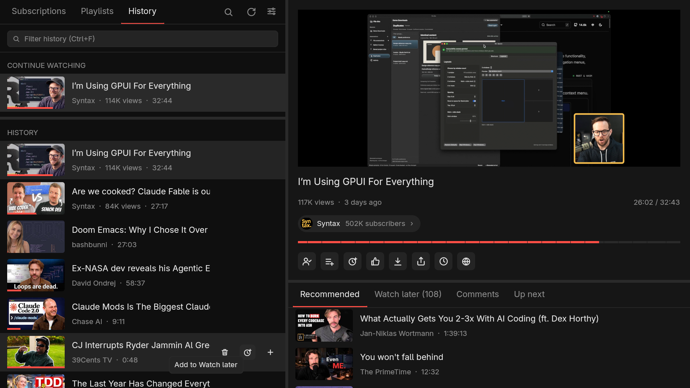

# UnbloatedTube

> **Alpha software.** It works day to day for its author, but it is young: expect rough edges, bugs
> and changes between versions (settings, shortcuts and files may change). Linux only for now (X11 and Wayland).
> Bug reports and feedback are welcome.

A lightweight, configurable YouTube desktop client, written in Rust with
[GPUI](https://crates.io/crates/gpui) (the UI framework behind the Zed editor), with
[mpv](https://mpv.io) for playback and [yt-dlp](https://github.com/yt-dlp/yt-dlp) for data.

It is **keyboard-driven**: playback, lists, tabs, panes and column layout all have shortcuts;
`Tab` moves a visible focus ring through every button, row and switch (`Enter` presses it); and an
optional Vim mode adds Vimium-style [hint mode](docs/features.md#vim-mode) to click anything without the mouse.

> **Renamed in 0.34.0** from *unbloated-youtube*. The command is now `unbloatedtube` (or `ubt`);
> `unbloated-youtube` still works as an alias. Settings, history, downloads and caches move to
> the new folders by themselves on first start. Arch: the package is now `unbloatedtube-bin`,
> and `unbloated-youtube-bin` moves you over on the next upgrade. Nix: the flake output is
> `unbloatedtube` (`unbloated-youtube` stays as an alias).

## Why

I wanted YouTube as **its own app**, so that YouTube tabs stop piling up in my browser, and
with a UI that does what I need and nothing else.

The YouTube web UI gets in the way of the basics:

- **Playlists are hard to manage.** Adding a video to a playlist opens a small popup with no
  search, so with many playlists you scroll and hunt. Seeing a playlist's contents, or
  removing a video, is several clicks deep.
- **Subscriptions are buried.** The channel list is tucked away in a sidebar or a separate
  page, and the subscriptions feed mixes everything into one endless scroll.
- **Shorts everywhere.** I'm usually not interested in them, and the web UI keeps pushing them.
- **Recommendations and ads.** The home page is a recommendation feed, and videos have
  sponsor reads in them.

So here most things can be turned off in Settings: Shorts, recommendations, whole tabs, every
button under the player, and sponsor segments (via SponsorBlock). What's left is a channel
list, your playlists, your history, search and a player.

## What it does today

- **Subscriptions as a channel list**, with groups, a New uploads feed, muted channels, hidden
  words and upload notifications; Shorts, recommendations and whole tabs can be switched off.
- **Playlists done right**: a search-as-you-type Save picker, remove from a playlist, and create,
  rename, delete and set the privacy or description of your own playlists; save the Up next queue
  as a playlist; clear watched videos out of Watch later; icons show which playlists are private,
  unlisted or public.
- **A player that stays out of the way**: Up next, picture-in-picture or a separate window,
  chapters, transcript, comments, quality and speed pickers, subtitles, sleep timer, SponsorBlock,
  DeArrow titles and thumbnails, downloads.
- **Keyboard first**: shortcuts everywhere, a focus ring on `Tab`, and an optional Vim mode with
  Vimium-style hints.
- **Plays and casts links**: `unbloatedtube <youtube link>`, media keys (MPRIS), cast to other
  devices.
- **Works on networks that block or slow YouTube**: TLS-split bypass, or a proxy (Tor, ByeDPI).

The full list is in [docs/features.md](docs/features.md).

## Install

| How | Notes |
|---|---|
| **AppImage** | one file from the [Releases](https://github.com/antlis/UnbloatedTube/releases): `chmod +x` and run |
| **Prebuilt archive** | Linux x86_64 from the Releases (glibc 2.35 or newer) |
| **Arch (AUR)** | `unbloatedtube-bin` |
| **Nix / NixOS** | `nix run github:antlis/UnbloatedTube` (a flake; a binary cache avoids the long build) |
| **From source** | `cargo build --release` (needs the libraries listed in the install guide) |

It needs `mpv` (with `libmpv`), `yt-dlp` and `deno` at run time, except where a package brings them
(Nix does). Details, dependencies and the Wayland notes are in [docs/install.md](docs/install.md).

## Getting started

1. Start it. Search and public playlists work without an account.
2. For your subscriptions, playlists and history: Settings → **Connect YouTube**, pick the browser
   you are logged in with ([how the login works and its limits](docs/login.md)).
3. Press `?` for the shortcuts. Almost everything can be turned off in Settings.

## Documentation

| | |
|---|---|
| [Features](docs/features.md) | everything the app does, and the keyboard shortcuts |
| [Install and run](docs/install.md) | packages, dependencies, Wayland, Nix, where files live |
| [Logging in](docs/login.md) | how the cookie login works, and its limits |
| [Blocked or slow YouTube](docs/network.md) | bypass, proxy, troubleshooting the connection |
| [Command line, media keys, casting](docs/integrations.md) | `unbloatedtube <link>`, MPRIS, cast targets |
| [Roadmap](docs/roadmap.md) | what is next, ranked |
| [Design notes](docs/design-notes.md), [Architecture](ARCHITECTURE.md) | how it is built |
| [Research notes](docs/research/) | measurements and decisions (JavaScript runtimes, AppImage, libmpv) |
| [Changelog](CHANGELOG.md) | version history |

## Files

- `~/.config/unbloatedtube/`: `config.toml` (optional login override), `auth.json` (the app's own login choice, set from Settings), `settings.json` (everything from the Settings page)
- `~/.local/share/unbloatedtube/`: watch history with resume positions, seen videos, groups, channel flags, Up next, recent searches
- `~/.cache/unbloatedtube/`: thumbnails, cached lists, `mpv.log`

Folders from the app's old names (`unbloated-youtube`, before that `jtube`) are moved over
automatically on first start.

## License

[GNU AGPLv3](LICENSE) (`AGPL-3.0-only`): you may use, change and share it, and anything you
distribute (or run for others over a network) from this code must come with its source under the
same license. Contributions are welcome, and are licensed under the same terms. Versions up to
0.21.3 were released under the MIT license and stay available under it.
